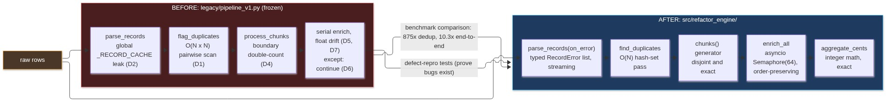
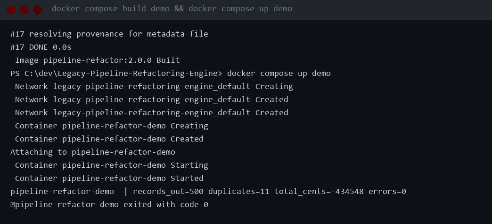
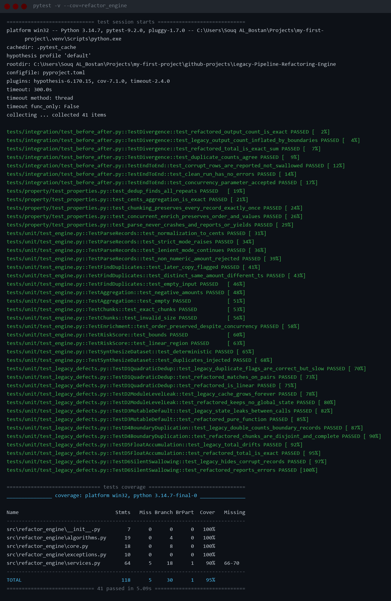
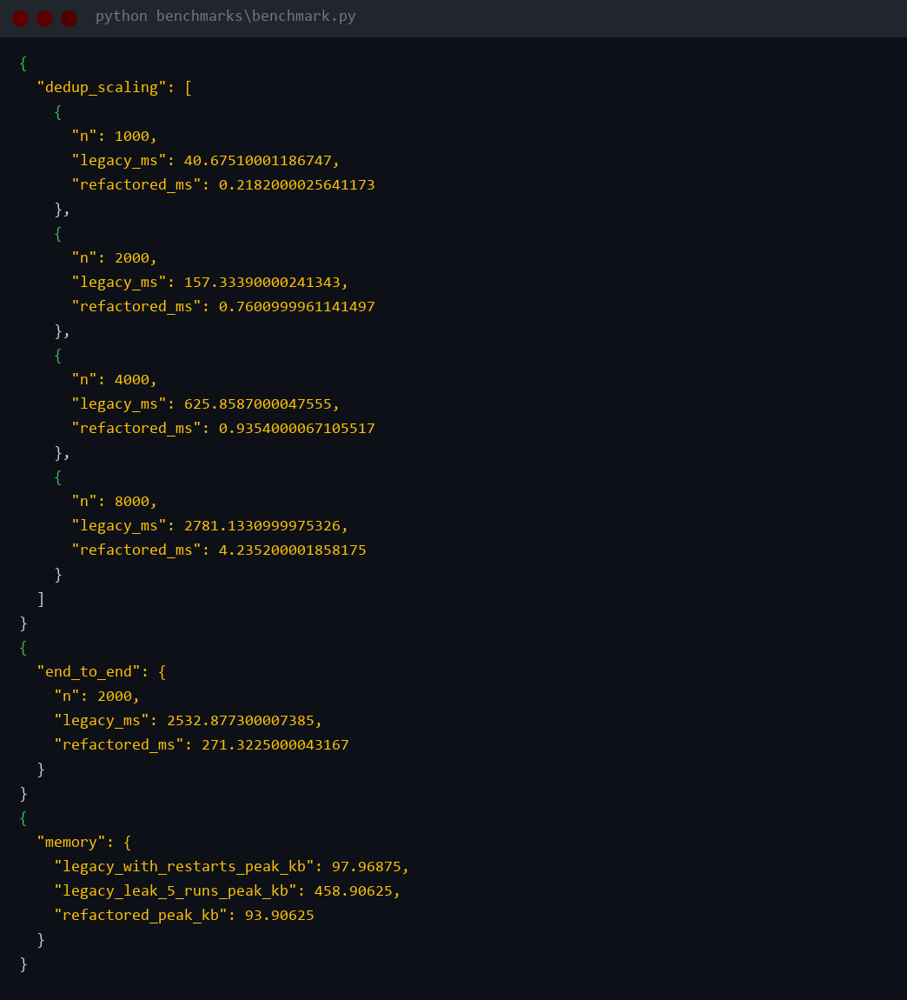

# Legacy-Pipeline-Refactoring-Engine

**A professional Python engineering project demonstrating codebase refactoring, performance optimization, and complex debugging -- a flawed legacy data pipeline modernized into a concurrent, exact system with measured 10.3x speedup.**

[](LICENSE)
[](https://opencode.ai)


## 1. Project Overview

**Problem.** A legacy transaction-processing pipeline (preserved frozen in
`legacy/pipeline_v1.py`) "works" on small inputs but is quietly wrong and
slow at scale: quadratic duplicate detection, a process-lifetime memory
leak, duplicate-processed chunk boundaries, drifting float money totals,
silently swallowed errors, and serial I/O.

**Why it is technically challenging.** The defects are *subtle* -- outputs
look plausible (601 records for 600 inputs; totals off by pennies), no
error is ever raised, and each bug hides behind plausible-looking code.
Finding them required profiling, complexity analysis, and memory tracing,
not code review alone.

**Solution.** A ground-up reimplementation with the same public contract:
O(N) deduplication, stateless streaming, exact integer-cent money math,
typed error reporting, and bounded-concurrency asyncio -- every improvement
pinned by a repro test, a property test, or a reproducible benchmark.

## 2. Key Features

- Frozen legacy "before" state with six documented defects (D1-D6) plus a
  performance defect (D7), each reproducible by test.
- O(N) hash-based deduplication: **875x faster at 8k records**.
- Bounded asyncio concurrency: **10.3x end-to-end speedup** at realistic
  I/O latency, with deterministic output order.
- Exact integer-cent aggregation: money never touches binary floats.
- Typed error reporting: corrupt rows are itemized, never swallowed.
- Memory-leak evidence via `tracemalloc`: 4.7x legacy growth vs flat.
- Hypothesis property suite with independent oracles (brute-force dedup,
  Decimal sums, chunk exactness, parser fuzzing).
- Reproducible Docker environment and CI with benchmark job.

## 3. System Architecture



Full component comparison and data-flow narrative:
[`docs/architecture.md`](docs/architecture.md). The two engines are shown
stage by stage; the refactored flow is
parse(validate/report) → dedupe(O(N)) → chunk(exact) → enrich(async,
bounded) → aggregate(exact).

## 4. Technology Stack

| Technology | Purpose |
|---|---|
| Python 3.11+ | Core implementation, full type hints |
| asyncio | Bounded-concurrent I/O enrichment |
| tracemalloc | Memory-leak evidence (stdlib) |
| Pytest | Automated testing |
| Hypothesis | Property-based testing with independent oracles |
| Ruff | Linting and code quality |
| MyPy (strict) | Static type checking |
| GitHub Actions | CI with benchmark job |
| Docker Compose | One-command reproducible environment |

## 5. Repository Structure

| Path | Purpose |
|---|---|
| `legacy/pipeline_v1.py` | Frozen "before" state -- six defects, benchmark baseline |
| `src/refactor_engine/` | "After" state: `algorithms.py` (O(N) core), `services.py` (concurrent pipeline), `core.py` (dataset synthesis), `exceptions.py` |
| `tests/unit/test_legacy_defects.py` | One repro test per legacy defect |
| `tests/unit/test_engine.py` | Refactored-engine behavior |
| `tests/property/` | Hypothesis oracle tests |
| `tests/integration/` | Before/after divergence proofs |
| `docs/` | Architecture, before/after table, debugging log, design decisions, security |
| `benchmarks/` | Reproducible benchmark + measured results |
| `scripts/` | Setup and test runner |
| `.github/workflows/` | CI: quality matrix + benchmark + compose smoke test |

## 6. Installation and Setup

```bash
git clone https://github.com/<you>/Legacy-Pipeline-Refactoring-Engine
cd Legacy-Pipeline-Refactoring-Engine

# Option A: zero-config Docker (recommended)
docker compose build

# Option B: local environment
python -m venv .venv
source .venv/bin/activate          # Windows: .venv\Scripts\activate
pip install -r requirements.txt
pip install -e .
```

Zero manual configuration; no external services.

## 7. Execution

```bash
# Run the refactored pipeline on a synthetic 500-record batch
docker compose up demo

# Run the full before/after benchmark (legacy vs refactored)
docker compose run --rm benchmark

# Tear down
docker compose down
```

Expected demo output:
`records_out=500 duplicates=... total_cents=... errors=0`.



## 8. Testing and Verification

```bash
pytest -v                                        # everything
pytest -v --cov=refactor_engine --cov-report=term-missing
```

Test layers:

- **Defect repro tests** (`test_legacy_defects.py`) -- prove each legacy
  defect exists: quadratic dedup scaling, cache growth, cross-call state
  leak, boundary double-counting, float drift, silent swallowing.
- **Unit tests** -- parser strict/lenient modes, dedup semantics,
  chunking, concurrency order, risk-score bounds.
- **Property tests** -- Hypothesis vs independent oracles: brute-force
  pairwise dedup, `Decimal` reference sums, chunk exactness for any
  size, order preservation under concurrency, parser fuzzing.
- **Integration tests** -- the two engines on identical datasets:
  refactored emits exactly 600 records where legacy emits 601;
  refactored totals match a Decimal reference; duplicate counts agree.

Measured results: **41 tests, 95% branch coverage, all passing**;
screenshot evidence in `docs/images/`.



## 9. Performance Benchmarking

Reproducible via `python benchmarks/benchmark.py`; full tables in
[`benchmarks/results.md`](benchmarks/results.md).

- Dataset: synthetic transaction logs (deterministic seeds), 1k-8k
  records with 5% injected duplicates; 0.5 ms simulated I/O per record.
- Dedup scaling: legacy 34.6 → 139.5 → 553.0 → 2,204.7 ms (exact 4x
  growth per doubling = quadratic) vs refactored 0.19 → 0.39 → 0.80 →
  2.52 ms (linear). **875x at 8k records.**
- End-to-end: legacy 2,546.7 ms vs refactored 247.6 ms = **10.3x**,
  consistent with the 64-concurrency bound minus scheduling overhead.
- Memory: legacy cache grows 4.7x across runs (458.9 KB peak); the
  refactored engine is flat (93.9 KB).



## 10. Debugging and Problem Resolution

Every defect documented with symptom → root cause → debugging approach →
fix → regression test in
[`docs/debugging-log.md`](docs/debugging-log.md). Highlights:

- **D1 (O(N²))** identified by timing growth analysis (exact 4x per
  doubling), fixed with a hashable-key single pass.
- **D2 (leak)** proven with `tracemalloc` across runs with/without cache
  clearing.
- **D4 (boundary duplication)** proven by counting records out vs in
  (601 vs 600).
- **Bonus:** property-based fuzzing of the *new* parser caught an
  `OverflowError` gap in the fix itself -- fixed and pinned.

## 11. Design Decisions

Full rationale in [`docs/design-decisions.md`](docs/design-decisions.md):

- **Integer cents over Decimal**: exactness with near-float speed.
- **asyncio over threads/processes**: I/O-bound workload, bounded
  semaphore, deterministic in-order output.
- **Lenient parse with typed error callback**: one corrupt row must not
  destroy the batch, but nothing may vanish silently.
- **Frozen legacy module**: the "before" state is evidence, not dead code.

## 12. Security Considerations

Documented in [`docs/security.md`](docs/security.md): strict input
validation with overflow handling, no injection surface (hermetic tests
and benchmarks), bounded concurrency as a resource-DoS guard, no bare
excepts (lint-enforced), and explicit limitations.

## 13. Limitations

- The enrichment stage simulates I/O latency; production wiring (HTTP,
  retries, TLS) is intentionally out of scope to keep benchmarks
  deterministic.
- `run_pipeline` materializes the enriched batch; streaming aggregation
  for larger-than-memory inputs is future work.
- The benchmark machine matters: ratios are robust, absolute times vary.

## 14. Future Improvements

- True streaming aggregation (constant memory for unbounded inputs).
- Pluggable enrichment backends with retry/backoff policies.
- Prometheus metrics export for production-shaped observability.
- Contract tests locking the public result schema for downstream users.

## 15. License

MIT License -- see [LICENSE](LICENSE).
