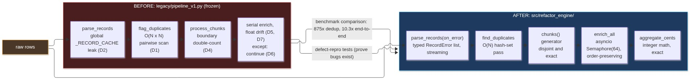

# System Architecture



## The two engines

```
BEFORE (legacy/pipeline_v1.py)              AFTER (src/refactor_engine/)

raw rows                                    raw rows
   │                                           │
   ▼                                           ▼
parse_records ── appends to ──► _RECORD_CACHE (never cleared)      parse_records(on_error) ──► typed RecordError list
   │ (global leak, D2)                        │ (streaming, no globals)
   ▼                                           ▼
flag_duplicates                             find_duplicates
   O(N²) pairwise scan (D1)                    O(N) hash-set pass
   │                                           │
   ▼                                           ▼
process_chunks                              chunks() generator ── disjoint, exact (R4)
   slice overrun: boundary ×2 (D4)             │
   │                                           ▼
   ▼                                        enrich_all ── asyncio Semaphore(64), order-preserving (R7)
_enrich_simulated: time.sleep per record       │
   serial (D7)                                 ▼
   │                                        aggregate_cents ── integer math, exact (R5)
   ▼
aggregate: float accumulation (D5),
except: continue swallows errors (D6)
```

## Refactored data flow

1. **Parse** -- raw rows stream through validation; corrupt rows are
   reported as typed `RecordError`s and skipped, never silently dropped.
2. **Deduplicate** -- one pass builds a set of `(account, cents, ts)`
   keys; later copies are flagged by id, in input order.
3. **Chunk** -- an explicit generator yields disjoint, complete chunks
   (every record exactly once, provable for any size).
4. **Enrich concurrently** -- each chunk runs through a bounded asyncio
   pool; results are awaited in input order so output is deterministic.
5. **Aggregate** -- integer-cent summation; totals are exact by
   construction. The result carries `records_out`, `duplicates`,
   `total_cents` and `errors`.

## Why the "before" state is kept as code

The legacy module is not documentation, it is an executable artifact:
benchmarks import it, defect-repro tests import it, and integration
tests prove the two engines *disagree exactly where the legacy bugs
bite* (601 vs 600 records; drifting vs exact totals). Deleting it would
delete the evidence.
